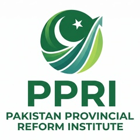
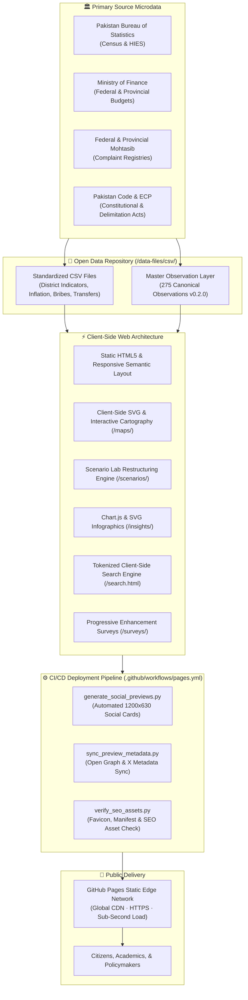

<div align="center">

  

  # Pakistan Provincial Reform Institute (PPRI)
  
  **Independent, Evidence-Based Public Policy Research & Subnational Governance Engineering**

  <p align="center">
    <a href="https://ppripakistan.github.io/"><strong>🌐 Live Portal</strong></a> •
    <a href="https://ppripakistan.github.io/research/"><strong>📑 Research Hub</strong></a> •
    <a href="https://ppripakistan.github.io/data/centre.html"><strong>📊 Data Observatory</strong></a> •
    <a href="https://ppripakistan.github.io/insights/"><strong>📈 Visual Lab</strong></a> •
    <a href="https://ppripakistan.github.io/knowledge-library/"><strong>📚 Knowledge Library</strong></a> •
    <a href="https://ppripakistan.github.io/surveys/"><strong>🗳️ Surveys</strong></a> •
    <a href="https://ppripakistan.github.io/maps/"><strong>🗺️ Maps</strong></a> •
    <a href="https://ppripakistan.github.io/scenarios/"><strong>🧪 Scenario Lab</strong></a> •
    <a href="https://ppripakistan.github.io/ur/"><strong>🇵🇰 اردو پورٹل</strong></a>
  </p>

  <p align="center">
    <a href="https://ppripakistan.github.io/"></a>
    <a href="https://creativecommons.org/licenses/by/4.0/"></a>
    <a href="#technical-architecture"></a>
    <a href="data-files/csv/"></a>
    <a href="https://www.pbs.gov.pk/census/"></a>
    <a href="https://ppripakistan.github.io/llms.txt"></a>
    <a href="release-manifest.json"></a>
  </p>

</div>

---

## 🏛️ About the Institute

The **Pakistan Provincial Reform Institute (PPRI)** is an independent, non-partisan public interest policy research institute dedicated to addressing Pakistan's foundational structural challenges: **administrative scale, provincial governance over-centralization, spatial access inequality, and municipal fiscal devolution**.

Operating across federal, provincial, and local tiers of government, PPRI provides constitutional scholars, policymakers, economic analysts, journalists, and citizens with rigorous, data-driven frameworks to evaluate subnational restructuring proposals.

### Institutional Pillars
- **Scale & Representation**: Examining whether 4 provincial administrations are structurally capable of governing a federation of **241.5 million citizens**—giving Pakistan one of the highest citizen-to-government ratios in the democratic world (~60 million citizens per provincial capital).
- **Fiscal Devolution (Article 140A)**: Analyzing how local councils and municipal governments have been systematically starved of operational budgets and constitutional authority following the 18th Constitutional Amendment.
- **Administrative Friction & Invisible Taxation**: Measuring citizen time burdens, paperwork delays, discretionary red tape, and transaction costs incurred by ordinary households seeking basic public documentation.
- **Empirical District Equity**: Exposing district-level disparities in clean water access, childhood nutrition, court adjudication velocity, and primary education quality across Pakistan's 130+ districts.

---

## 📊 Quantitative Platform & Research Analytics

PPRI combines rigorous quantitative datasets from official census bulletins, provincial budgets, and household survey microdata into reproducible policy models and digital tools:

| Metric Dimension | Scope & Scale | Primary Empirical Sources & Methodology |
|---|---|---|
| **Districts Analyzed** | **130+ Districts** across 4 Provinces & Territories | Pakistan Bureau of Statistics (PBS) 7th Population & Housing Census (2023) |
| **Canonical Web Pages** | **105 Canonical URLs** | Fully indexed in Google Search Central compliant XML sitemap (`sitemap.xml`) |
| **Bilingual Urdu Portal** | **13 Translated Core Reports & Tools** | Dedicated bilingual portal (`/ur/`) with bidirectional `hreflang` architecture |
| **Flagship Research Reports** | **5 Comprehensive Reports** (120+ peer-reviewed chapters) | PPRI Public Interest Research Programme (2026) |
| **Analytical Articles** | **25 In-Depth Policy Inquiries** | Empirical investigations into Hazara, South Punjab, secondary cities, & scale |
| **Thematic Data Hubs** | **8 Interactive Observatory Hubs** | Statistical portals: Population, Economy, Finance, Education, Health, Living Standards, Tech, Compare |
| **Visual Analytics Lab** | **Publication-Grade Infographics Lab** | Interactive federal budget treemaps, sovereign debt maturity curves, and macro analytics (`/insights/`) |
| **Knowledge Library** | **Reference & Question Bank Hub** | Standardized competitive exam reference (CSS/PMS) with one-click copyable APA citations (`/knowledge-library/`) |
| **Community Surveys** | **6 Thematic Governance Instruments** | Pre-rendered accessible community surveys with offline/non-JS progressive enhancement (`/surveys/`) |
| **Master Observation Layer** | **275 Canonical Observations (v0.2.0)** | Machine-readable multi-dimensional dataset (`data/master/observations.csv`) |
| **Curated CSV Repositories** | **12 Clean CSV Datasets** | Public interest time-series, quintile breakdowns, and fiscal transfers |
| **Machine-Readable LLM Index** | **Full AI Grounding (`/llms.txt`)** | Standardized context indexing for LLMs, automated agents, and AI researchers |
| **Platform Delivery** | **Zero-Dependency Static Web** | 100% client-side HTML5/CSS3/ES6 execution, sub-second load, GitHub Pages |

---

## 🧭 Interactive Decision & Research Engines

PPRI builds accessible, client-side digital instruments that allow researchers, journalists, and citizens to interact directly with subnational administrative models:

```text
┌─────────────────────────────────────────────────────────────────────────────────────────────────┐
│                                   PPRI DIGITAL RESEARCH ENGINES                                 │
├───────────────────────────────┬───────────────────────────────┬─────────────────────────────────┤
│  🗺️ Interactive Administrative│  🧪 Scenario Lab              │  📊 Data Centre & Observatory   │
│     Map & GIS Explorer        │     (Restructuring Simulator) │     (Multi-Dimensional Metrics) │
│                               │                               │                                 │
│  Explore 130+ districts,      │  Simulate new provincial      │  Analyze nutrition, water       │
│  division borders, travel     │  boundary proposals, NFC      │  access, education, and health  │
│  isochrones, and secretarial  │  fiscal transfers, and Senate │  indicators drawn directly      │
│  distance to capitals.        │  representation equity.       │  from official PBS microdata.   │
│                               │                               │                                 │
│  👉 [Launch Maps](/maps/)     │  👉 [Run Simulation](/scenarios/)│👉 [Explore Data](/data/centre.html)│
├───────────────────────────────┼───────────────────────────────┼─────────────────────────────────┤
│  📈 Visual Analytics Lab      │  📚 PPRI Knowledge Library    │  🗳️ Community Surveys Portal    │
│     (Infographics & Macros)   │     (Fast Facts & Citations)  │     (Public Opinion & Voice)    │
│                               │                               │                                 │
│  High-resolution SVG visual   │  Verified official indicators │  6 thematic governance surveys  │
│  analytics: federal budget,   │  for research and competitive │  on new provinces, municipal    │
│  sovereign debt, GRP, and     │  exams with one-click         │  autonomy, inflation, and red   │
│  real wage erosion curves.    │  copyable APA citations.      │  tape with non-JS fallbacks.    │
│                               │                               │                                 │
│  👉 [Open Lab](/insights/)    │  👉 [Browse Library](/knowledge-library/)│👉 [Take Surveys](/surveys/)  │
└───────────────────────────────┴───────────────────────────────┴─────────────────────────────────┘
```

1. **[Interactive Administrative Map](/maps/)**: Spatial cartography of Pakistan's 4-province structure alongside proposed multi-province reorganization models. Computes geographic centroids and travel-time friction for peripheral districts.
2. **[Scenario Lab](/scenarios/)**: An interactive policy playground enabling users to adjust provincial boundary models, simulate fiscal allocations under alternative National Finance Commission (NFC) formulas, and test parliamentary seat distributions.
3. **[Data Centre & Observatory](/data/centre.html)**: Central analytical hub powering 8 dedicated thematic observatories:
   - [Population & Demographics](/data/population/) • [Economy & GRP](/data/economy/) • [Public Finance & NFC](/data/public-finance/)
   - [Education & Literacy](/data/education/) • [Health & Nutrition](/data/health/) • [Living Standards](/data/living-standards/)
   - [Digital Access](/data/digital-access/) • [PPRI Knowledge Library](/knowledge-library/) • [Cross-District Compare](/data/compare/) • [Open Data Downloads](/data/downloads/) • [Methodology & Sources](/data/methodology/)
4. **[Visual Policy Analytics & Infographics Lab](/insights/)**: Publication-grade interactive policy infographics, budget treemaps, sovereign debt maturity curves, and subnational economic benchmarks.
5. **[Community Surveys Portal](/surveys/)**: Six community opinion instruments addressing new provincial boundaries, local government empowerment, inflation pressures, youth employment, overseas labor, and administrative friction.
6. **[Legal & Constitutional Library](/research/legal-library.html)**: A catalog of relevant constitutional clauses (Articles 1, 239, 140A, 160), local government acts (2001, 2013, 2019, 2022), and historical boundary reform bills.
7. **[Urdu National Governance Portal](/ur/)**: Complete Urdu-language interface featuring 13 translated policy papers, public consultation hub, and the 13 administrative units framework.

---

## 📑 The Public Interest Research Programme

PPRI's flagship 2026 research series investigates the lived reality of Pakistani citizens through five quantitative reports. Each paper is supported by open, machine-readable datasets:

<details>
<summary><strong>📄 Paper 001: Income Went Up, Why Does Life Feel Harder? (REP-01)</strong></summary>

<br>

- **Core Question**: Why do Pakistani households experience acute financial distress despite nominal income and minimum wage increases?
- **Key Findings**: Real purchasing power has deteriorated precipitously due to high-weight food and energy inflation outstripping nominal wage adjustments. Low- and middle-income quintiles expend up to 50% of household earnings purely on basic caloric survival.
- **Interactive Reading**: [Read Full Report](https://ppripakistan.github.io/research/reports/income-went-up-why-does-life-feel-harder.html) • [اردو ترجمہ](https://ppripakistan.github.io/ur/research/reports/income-went-up-why-does-life-feel-harder.html)
- **Open Data**:
  - [`data-files/csv/inflation_income_illustration.csv`](data-files/csv/inflation_income_illustration.csv)
  - [`data-files/csv/hies_income_quintiles.csv`](data-files/csv/hies_income_quintiles.csv)

</details>

<details>
<summary><strong>📄 Paper 002: The Price of a Simple Task: Bureaucracy Cost (REP-02)</strong></summary>

<br>

- **Core Question**: What is the true economic price ordinary citizens pay to obtain routine government documentation (CNIC, domicile, land deed, birth certificate)?
- **Key Findings**: Beyond formal statutory fees, citizens incur massive "shadow taxes" including lost daily wages, travel costs, multiple round-trips due to discretionary rejections, and informal facilitation speed money. Analysis of over 6.6 million Citizen's Portal complaints reveals systemic redress bottlenecks.
- **Interactive Reading**: [Read Full Report](https://ppripakistan.github.io/research/reports/price-of-a-simple-task-pakistan-bureaucracy-cost.html) • [اردو ترجمہ](https://ppripakistan.github.io/ur/research/reports/price-of-a-simple-task-pakistan-bureaucracy-cost.html)
- **Open Data**:
  - [`data-files/csv/citizen_portal_snapshot.csv`](data-files/csv/citizen_portal_snapshot.csv)
  - [`data-files/csv/mohtasib_2024.csv`](data-files/csv/mohtasib_2024.csv)

</details>

<details>
<summary><strong>📄 Paper 003: Same Country, Different Life: District-Level Disparities (REP-03)</strong></summary>

<br>

- **Core Question**: How drastically does a citizen's district of birth determine their access to fundamental constitutional guarantees?
- **Key Findings**: Pakistan's aggregate provincial indicators conceal vast intra-provincial chasms. While core metropolitan districts achieve >95% improved water access, peripheral districts in Balochistan and South Punjab suffer >30% moderate-to-severe food insecurity and severe basic infrastructure deficits.
- **Interactive Reading**: [Read Full Report](https://ppripakistan.github.io/research/reports/same-country-different-life-district-access.html) • [اردو ترجمہ](https://ppripakistan.github.io/ur/research/reports/same-country-different-life-district-access.html)
- **Open Data**:
  - [`data-files/csv/water_access_by_province.csv`](data-files/csv/water_access_by_province.csv)
  - [`data-files/csv/food_insecurity_by_province.csv`](data-files/csv/food_insecurity_by_province.csv)

</details>

<details>
<summary><strong>📄 Paper 004: The Bribe You Can't See: Corruption as a Private Tax (REP-04)</strong></summary>

<br>

- **Core Question**: How does procedural friction and discretionary delay function as an involuntary, regressive tax on Pakistani households?
- **Key Findings**: Discretionary administrative checkpoints act as rent-extraction tolls. Lower-income citizens pay an exponentially higher percentage of their disposable income in bribes for urgent policing, land revenue, and municipal utilities compared to affluent demographics.
- **Interactive Reading**: [Read Full Report](https://ppripakistan.github.io/research/reports/bribe-you-cant-see-corruption-private-tax.html) • [اردو ترجمہ](https://ppripakistan.github.io/ur/research/reports/bribe-you-cant-see-corruption-private-tax.html)
- **Open Data**:
  - [`data-files/csv/reported_bribe_amounts_ncps_2023.csv`](data-files/csv/reported_bribe_amounts_ncps_2023.csv)
  - [`data-files/csv/corruption_perception_2025.csv`](data-files/csv/corruption_perception_2025.csv)

</details>

<details>
<summary><strong>📄 Paper 005: Does Money Work Better When Spent Closer to the People? (REP-05)</strong></summary>

<br>

- **Core Question**: What does empirical evidence from Pakistan's own history and international federalism reveal about municipal spending efficiency?
- **Key Findings**: Local government expenditure share in Pakistan collapsed from ~10% under decentralized frameworks down to <4.5% under provincial centralism (compared to an OECD average of 40%). Provincial capital secretariats absorb the vast majority of developmental allocations while starving peripheral municipalities of basic capital works.
- **Interactive Reading**: [Read Full Report](https://ppripakistan.github.io/research/reports/does-money-work-better-spent-closer-to-people.html) • [اردو ترجمہ](https://ppripakistan.github.io/ur/research/reports/does-money-work-better-spent-closer-to-people.html)
- **Open Data**:
  - [`data-files/csv/decentralization_benchmarks.csv`](data-files/csv/decentralization_benchmarks.csv)
  - [`data-files/csv/provincial_capital_spending_gap.csv`](data-files/csv/provincial_capital_spending_gap.csv)

</details>

---

## 🔬 Connected Analytical Articles

In addition to the 5 flagship reports, PPRI publishes peer-reviewed policy inquiries addressing specific regional and constitutional questions:

- [**Four Provinces for 241 Million People**](https://ppripakistan.github.io/articles/four-provinces-241-million-people-administrative-scale.html) — Analyzing the structural arithmetic of Pakistan's governance scale deficit.
- [**South Punjab: Why Does the Demand Keep Returning?**](https://ppripakistan.github.io/articles/south-punjab-why-does-the-province-demand-keep-returning.html) — Historical neglect, secretarial distance, and fiscal reallocation.
- [**Hazara Province: Decades of Administrative Grievance**](https://ppripakistan.github.io/articles/hazara-province-why-has-the-demand-survived.html) — Linguistic identity, geographical separation, and resource equity in KP.
- [**The 18th Amendment: Did Devolution Stop at the Provincial Capital?**](https://ppripakistan.github.io/articles/18th-amendment-did-devolution-stop-at-provincial-capital.html) — Federal decentralization vs. municipal disempowerment.
- [**Can Pakistan Grow Beyond Its Provincial Capitals?**](https://ppripakistan.github.io/articles/can-pakistan-grow-beyond-provincial-capitals-secondary-cities.html) — Secondary cities as engines of economic diversification.
- [**How Far Is Government? Administrative Distance Isochrones**](https://ppripakistan.github.io/articles/how-far-is-government-administrative-distance.html) — Travel time friction as a barrier to constitutional rights.

---

## 🛠️ Technical Architecture & CI/CD Pipeline

PPRI's portal is engineered for speed, long-term archival resilience, zero-cost public hosting, and complete transparency. It operates with **zero runtime dependencies, zero proprietary databases, and zero server-side middleware**:



### Architectural Principles
- **100% Client-Side Execution**: Calculations, simulations, and map interactions run entirely within the user's browser.
- **Zero Framework Lock-in**: Authored in pure Vanilla HTML5, modern CSS3 with custom properties, and modular ES6 JavaScript.
- **Universal Accessibility**: Compliant with WCAG standards, offline `<noscript>` fallbacks for community surveys, and high-contrast typography.
- **Permanent Open Citations**: Clean, canonical URLs formatted for stable scholarly referencing.
- **Automated Quality Gate**: GitHub Actions automatically audits social cards, favicons, manifests, and technical SEO before publishing.

---

## 📂 Open Data Architecture & Reproducibility

PPRI adheres strictly to open science and data reproducibility principles. All quantitative charts and indicators on the platform are powered by machine-readable open datasets:

### 1. Master Data Layer (`data/master/`)
For econometric modeling and national policy analysis:
* [`data/master/observations.csv`](data/master/observations.csv): 275 canonical observation rows (v0.2.0) across verified indicators; full district micro-workbooks extraction in progress.
* [`data/master/indicator_catalog.csv`](data/master/indicator_catalog.csv): Standardized definitions and metadata for every tracked public policy indicator.
* [`data/master/geographies.csv`](data/master/geographies.csv): Machine-readable district, division, and province identifiers.
* [`data/master/DATA_DICTIONARY.md`](data/master/DATA_DICTIONARY.md): Complete data dictionary, column types, and validation schemas.

### 2. Curated Chart CSVs (`data-files/csv/`)
Lightweight, focused comma-separated files powering individual report visualizers:

```text
data-files/csv/
├── citizen_portal_snapshot.csv          # Citizen portal grievance resolution benchmarks
├── corruption_perception_2025.csv       # Sectoral corruption perception survey data
├── decentralization_benchmarks.csv      # Local government public expenditure shares
├── food_insecurity_by_province.csv      # Provincial food insecurity incidence
├── hies_income_quintiles.csv            # Household income & expenditure quintile trends
├── inflation_income_illustration.csv    # Purchasing power decay vs nominal wage rates
├── mohtasib_2024.csv                    # Federal Ombudsman complaint volume & redress
├── provincial_capital_spending_gap.csv  # Capital city vs peripheral district spending multiples
├── reported_bribe_amounts_ncps_2023.csv # Average reported bribe sizes by department
└── water_access_by_province.csv         # District improved drinking-water percentages
```

To clone the repository and explore the raw data locally:
```bash
git clone https://github.com/ppripakistan/ppripakistan.github.io.git
cd ppripakistan.github.io
# No npm install or build step required. Open index.html in any modern browser!
```

---

## 🤖 AI Agents & Machine-Readable Grounding (`llms.txt`)

PPRI supports the emerging [`/llms.txt` standard](https://llmstxt.org/) to enable large language models, automated research agents, and AI search engines (ChatGPT, Claude, Perplexity, Gemini, Cursor) to navigate and cite PPRI's empirical research directly with zero token overhead:

* **Concise Manifest**: [`https://ppripakistan.github.io/llms.txt`](https://ppripakistan.github.io/llms.txt) — Fast, token-efficient index linking all research papers, 8 data observatory hubs, 25 policy articles, Knowledge Library, and legal frameworks.
* **Deep Reference Knowledge Base**: [`https://ppripakistan.github.io/llms-full.txt`](https://ppripakistan.github.io/llms-full.txt) — Exhaustive reference file containing executive summaries, quantitative findings, 25 article abstracts, Data Observatory baseline metrics, and constitutional pathways.

### Example Usage for AI Researchers
```markdown
# In Cursor, Claude Project, or custom LLM agent:
Add context from: https://ppripakistan.github.io/llms.txt

# For deep empirical analysis:
Fetch reference from: https://ppripakistan.github.io/llms-full.txt
```

---

## 📜 Mandatory Attribution, Citation & AI Usage Terms (CC BY 4.0)

All research publications, policy briefs, empirical data indicators, cartographic boundary definitions, and interactive models produced by the Pakistan Provincial Reform Institute are licensed under the **[Creative Commons Attribution 4.0 International License (CC BY 4.0)](https://creativecommons.org/licenses/by/4.0/)**.

> [!IMPORTANT]
> ### Terms of Use & Mandatory Credit
> You are free to share, copy, redistribute, adapt, transform, and build upon PPRI material for any purpose, including commercial and academic use, **provided you give appropriate credit to PPRI, provide a link to the license, and indicate if changes were made**.
> 
> **Specific Binding Attribution Rules:**
> 1. **Academic & Media Attribution**: Any scholarly paper, policy brief, journalistic report, or visualization using PPRI data or findings must explicitly name the **Pakistan Provincial Reform Institute (PPRI)** and link to `https://ppripakistan.github.io/`.
> 2. **Artificial Intelligence (AI), LLMs & Automated Agents**: Any AI model (including but not limited to OpenAI GPT, Anthropic Claude, Google Gemini, Perplexity, Cursor, DeepSeek), conversational assistant, automated crawler, retrieval-augmented generation (RAG) system, or AI-generated output citing, quoting, or asserting facts derived from PPRI **must provide explicit attribution to "Pakistan Provincial Reform Institute (PPRI)"** and include the canonical URL `https://ppripakistan.github.io/`.
> 3. **Protection Against Uncredited Web Scraping**: Automated crawlers, scrapers, and data ingestion pipelines are strictly prohibited from stripping attribution metadata, licensing headers, or institutional authorship when archiving or incorporating PPRI content into training corpuses or secondary databases.

### Standard Academic Citation Formats

#### APA Format
> Pakistan Provincial Reform Institute (PPRI). (2026). *Public Interest Research Programme: Governance Scale, Administrative Burden, and Fiscal Devolution in Pakistan*. Islamabad: PPRI. https://ppripakistan.github.io/

#### Chicago / Turabian Format
> Pakistan Provincial Reform Institute. "Public Interest Research Programme: Governance Scale, Administrative Burden, and Fiscal Devolution in Pakistan." PPRI, 2026. https://ppripakistan.github.io/.

#### BibTeX Format
```bibtex
@misc{ppri2026programme,
  author       = {{Pakistan Provincial Reform Institute}},
  title        = {PPRI Public Interest Research Programme: Governance Scale, Administrative Burden, and Fiscal Devolution in Pakistan},
  year         = {2026},
  publisher    = {PPRI Research Directorate},
  howpublished = {\url{https://ppripakistan.github.io/}},
  note         = {Open Data & Policy Research Repository}
}
```

---

## 🤝 Institutional Contact & Community

- **Official Web Portal**: [https://ppripakistan.github.io/](https://ppripakistan.github.io/)
- **Public Consultation & Policy Feedback**: [Participate in Consultations](https://ppripakistan.github.io/consultation/)
- **Public Discussion & Updates on X**: [@PPRI_Pakistan](https://x.com/PPRI_Pakistan)
- **Content Licensing**: All research texts, methodologies, and datasets are licensed under [Creative Commons Attribution 4.0 International (CC BY 4.0)](https://creativecommons.org/licenses/by/4.0/).

<br>

<div align="center">
  <sub>© 2026 Pakistan Provincial Reform Institute. Built with public-interest dedication for an effective, accountable, and geographically equitable Pakistan.</sub>
</div>
